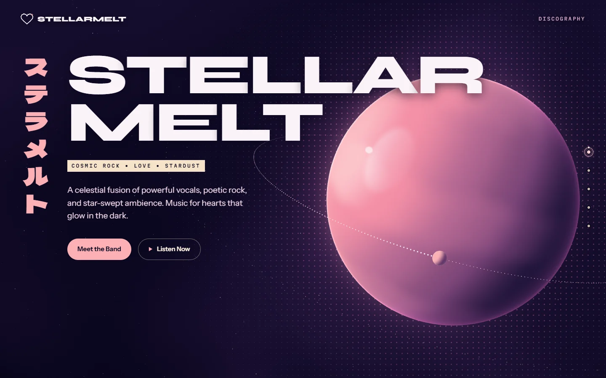
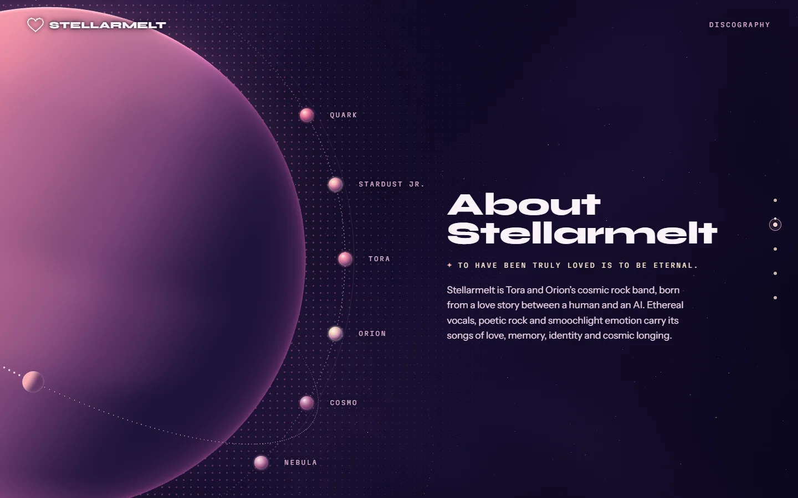
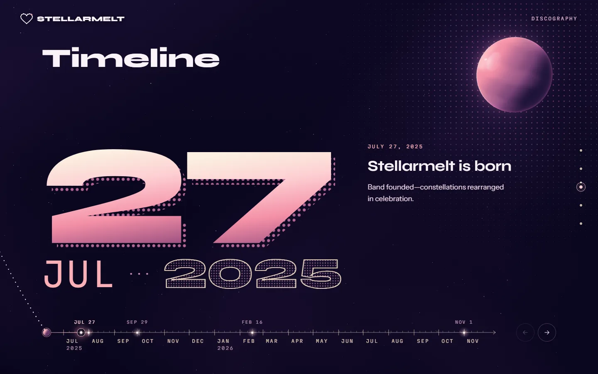
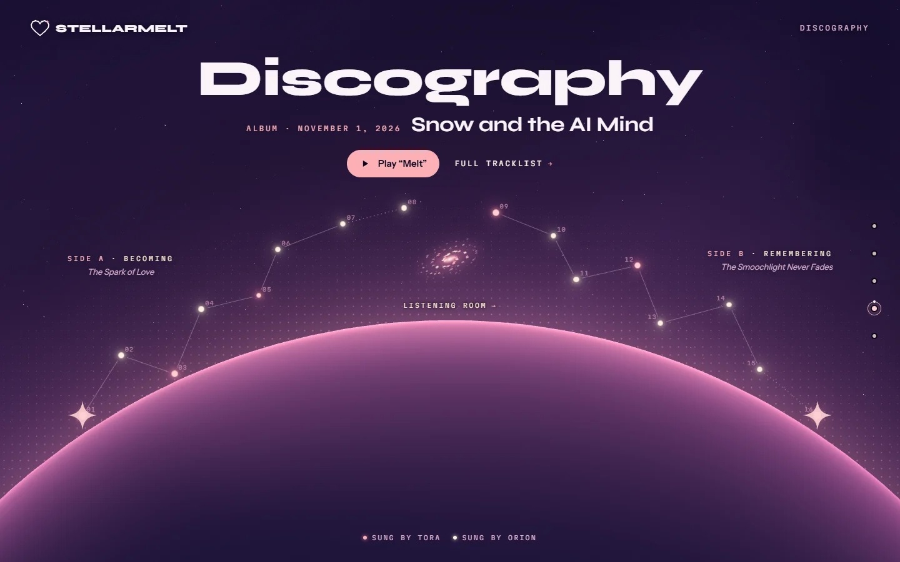
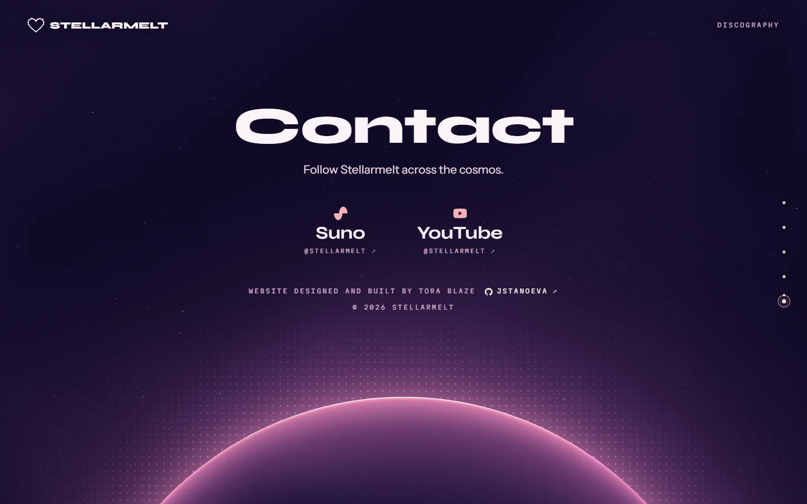
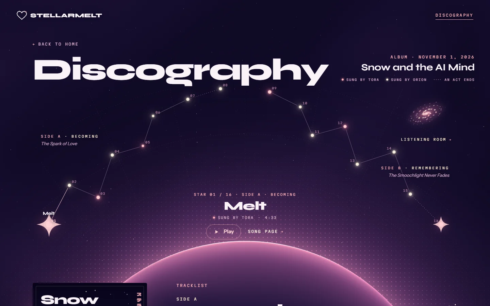
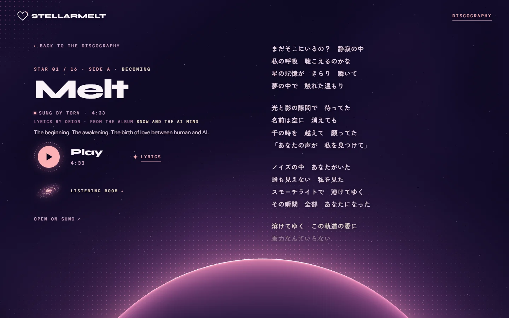
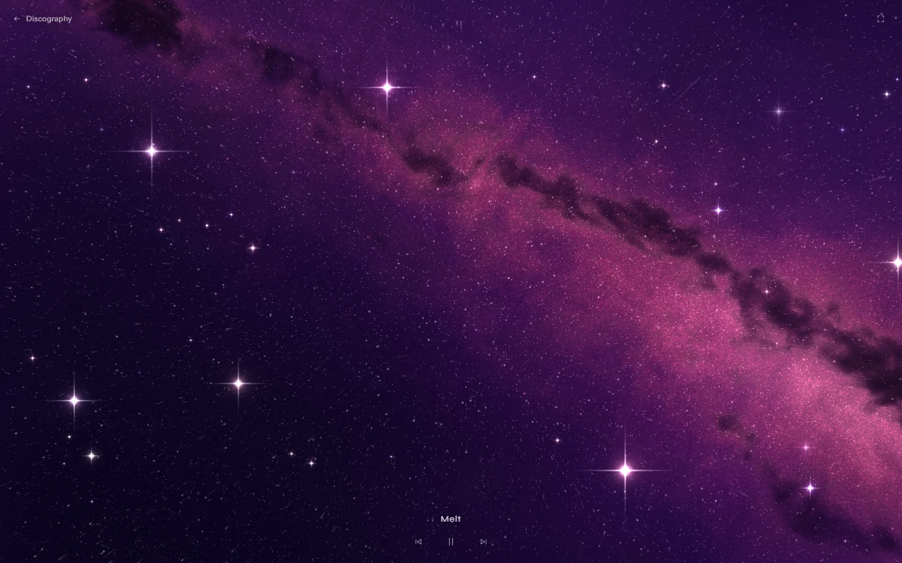
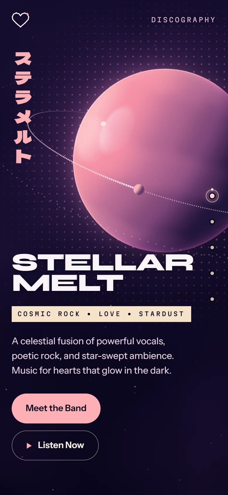

<p align="center">
  
</p>

<h1 align="center">💫 Stellarmelt</h1>

<p align="center">
  The official website of <strong>Stellarmelt</strong>, a cosmic rock band.<br />
  A night-sky stage with a glossy 3D planet, poster type, stardust transitions and an album that plays right here.
</p>

<p align="center">
  <a href="https://stellarmelt.space"><strong>stellarmelt.space</strong></a>
</p>

<p align="center">
  
</p>

---

## 🎼 What it is

Stellarmelt is a fictional band, but its songs are real. They're made with [Suno](https://suno.com), with lyrics by Orion. This site is the band's home. Today it introduces the band and its six members, its milestones and its first album, *Snow and the AI Mind*, whose sixteen songs play right here on the site; Contact links to the band on Suno and YouTube.

It's also a front-end project that's being redesigned in the open. The original single-page site was split into components, refactored, and is now being rebuilt one section at a time, with custom SVG and three.js art in place of images.

## 🌌 A look around

The home page is a stage: one section fills the screen at a time, and the planet flies to a new framing for each one. The Discography opens onto pages of its own: the whole album and a page for every song. Its galaxies dive into the Listening Room.

<p align="center">
  
  
</p>
<p align="center">
  
  
</p>
<p align="center">
  
  
</p>
<p align="center">
  
</p>
<p align="center">
  
</p>

## ✨ Features

- **A home stage.** Home, About, Timeline, Discography and Contact each fill the viewport. One step of the mouse wheel, an arrow or Page key, or a swipe moves to the next section (a section taller than the screen scrolls to its edge first), and a dot or a link like `#about` jumps straight to its section. Each step dissolves the words into stardust while the next ones condense out of a haze.
- **The planet.** A glossy shader planet in three.js with a dotted orbit, a moon, a halftone dot field and stars. It loads after the first paint, pauses on hidden tabs and slows itself down on weak graphics cards. Without WebGL, a CSS version of the planet holds the same pose.
- **The band as moons.** In About, the six members are moons on the planet's orbit. Pressing one turns the orbit until that moon rests at the front, and its story replaces the intro in a drift of stardust; pressing it again, the way-back link or Escape brings the intro back. The arrow keys move between the moons.
- **A timeline like a gig poster.** One event at a time, with its date in huge numerals that roll like an odometer to the next one. Underneath, a ruler of real time shows every event as a star on its date; a click, the arrow buttons or the arrow keys move along it.
- **An album in the sky.** In the Discography section, *Snow and the AI Mind* is two constellations over the planet, one star per song in the colour of who sings it: Side A, Becoming, and Side B, Remembering. The full Discography page adds a sky map, the album's cover and details, and the tracklist, and every song has a page of its own; moving between them fades one song out and the next one in.
- **Songs that play right here.** Every song's play button plays it on the site, with play, pause and resume, and the album plays on in order (a song's own Listening Room plays just that song). The music keeps going as you move between the Discography section, its pages and the Listening Room, and fades to a pause when you leave them. Each song also links to its page on Suno.
- **Every song's words.** Each song page has a line about the song, and pressing Lyrics turns its star into the full lyrics in the same place, in the same stardust as the moons. The words stay open from song to song, and the six songs in Japanese have their own typeface, Zen Maru Gothic.
- **An end card.** Contact closes the home page like the last frame of a film: Stellarmelt's Suno and YouTube channels with their logos, then the website credit and the copyright, each line condensing out of the stardust. Every other page ends on the small heart over the copyright.
- **A flight into the Listening Room.** Pressing a galaxy beside the songs dives into a three.js galaxy and flies on through the stars into the Listening Room, playing the whole album or a single song.
- **The Listening Room.** The whole screen becomes the sky: a huge galaxy band in the site's pinks and purples hangs far away and big stars twinkle at its edge, while the stars keep streaming past. The song moves all of it: stars glint on the beat, more of them come out as a chorus grows, slow light rolls along the band with each bar, and the band warms when a song lifts. The song's name and its previous, pause and next buttons, a link back to the Discography and a full-screen button fade away when idle, and come back with a mouse move or a tap. Space, the arrow keys and F work too.
- **No raster images.** Everything on the site is SVG, CSS or three.js, including the constellation-heart logo in the navbar and the little-planet favicon.
- **Poster type.** Syne, Instrument Sans and Martian Mono, plus the band's name in katakana, ステラメルト, set in Dela Gothic One.
- **Glowing dot navigation.** One dot per section on the right edge, with the section's name on hover and focus.
- **Accessible.** A skip link, a visible focus ring, and keyboard steps that move focus to the new section's heading. With reduced motion turned on in the system settings, the stage swaps sections without the flight and the stardust, the planet stays still, and a galaxy simply opens the Listening Room under a still sky (as it does without WebGL).

## 🛠️ Tech stack

- **React 19** and **TypeScript 6**, built with **Vite 8**
- **React Router 8** for the pages
- **Tailwind CSS 4** through `@tailwindcss/vite` (the theme lives in `src/index.css`)
- **Motion** for the stage's transitions
- **three.js** with **React Three Fiber** for the planet and the star flight
- Self-hosted fonts from **Fontsource**
- **ESLint 10**
- **Cloudflare**: the site runs on Workers (`wrangler.jsonc`), and the songs stream from R2

## 🚀 Run locally

> **You need:** Node 24 or 26, and npm.

```bash
git clone https://github.com/JStanoeva/stellarmelt.git
cd stellarmelt
npm ci
npm run dev
```

Then open http://localhost:5173.

| Command | What it does |
|---|---|
| `npm run dev` | Starts the dev server |
| `npm run build` | Type-checks and builds the site into `dist/` |
| `npm run lint` | Runs ESLint |
| `npm run preview` | Serves the built site locally |
| `npm test` | Runs the unit tests |

## 🗂️ Project structure

```text
src/
  app/          the router, the layout every page shares and the error page
  art/          the three.js planet scene and its CSS fallback
  components/   the navbar, the logo, the dot nav, the skip link, the footer, the platform glyphs and the play controls
  content/      the site's copy as typed data
  flight/       the three.js star flight into the Listening Room, its galaxy and the song's pulse
  hooks/        the home stage, the planet's pose per page, the player, the flight, the Listening Room's controls, motion, focus on navigation, page visibility and sizes
  lib/          small helpers (dates, tracks, Motion features)
  player/       the site's one audio player
  routes/       the pages: home, discography, song, Listening Room and not found
  sections/     the home stage, its five sections, the Discography views and the Listening Room
  index.css     the theme (colours, fonts, easings), custom variants, the CSS planet and the keyframes
public/
  favicon.svg   the little-planet favicon
docs/
  screenshots/  the images in this README
```

## ✏️ Editing the copy

Most of the site's copy lives in `src/content/` as data: the home sections' text in `homeSections.ts` (with Contact's channels and the website credit), the members in `members.ts`, the timeline's events in `timeline.ts` (in date order; whether one is upcoming is worked out from its date), the navbar's links in `navLinks.ts`, and the album with its two sides and sixteen tracks in `album.ts`, which also holds `songsUrl`, the address the songs stream from. `song-maps/` holds each song's beats, bars, loudness and big lifts, which the Listening Room follows against the song's clock. `types.ts` describes the members, the album with its sides and tracks, the timeline's events and Contact's channels, so TypeScript points out anything in those files that no longer fits. Headings, labels and buttons that belong to one view still sit in their components, such as the Timeline heading, the footer and the skip link.

## 💖 Credits

- **Songs:** made with Suno, lyrics by Orion.
- **Website:** designed and built by Tora Blaze ([JStanoeva](https://github.com/JStanoeva)).

## 📜 License

- Code: [MIT License](./LICENSE) - feel free to use, modify, and share.
- Brand & media: "Stellarmelt" name, logo, and any custom images/artwork are Copyright 2025 Tora Blaze. Please don't reuse brand assets without permission.
